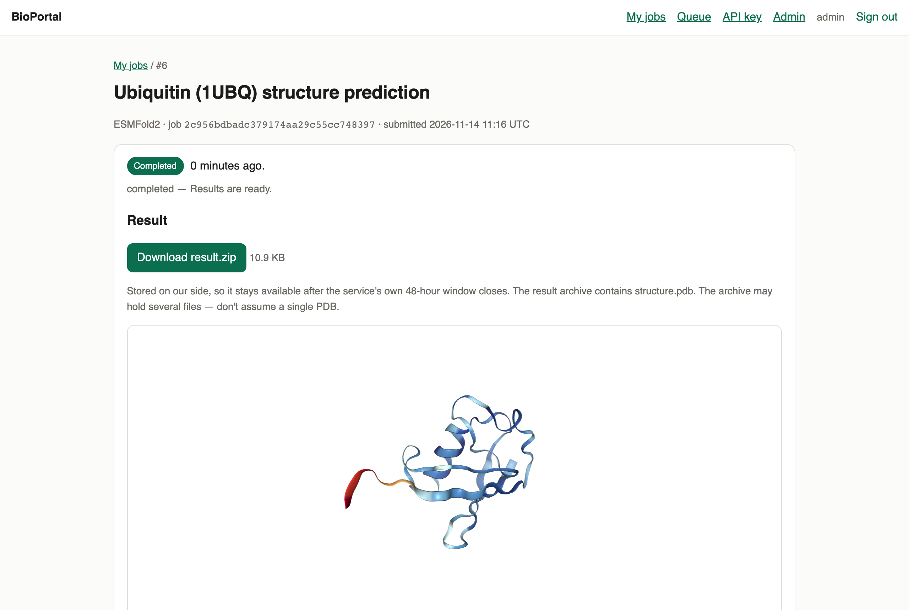
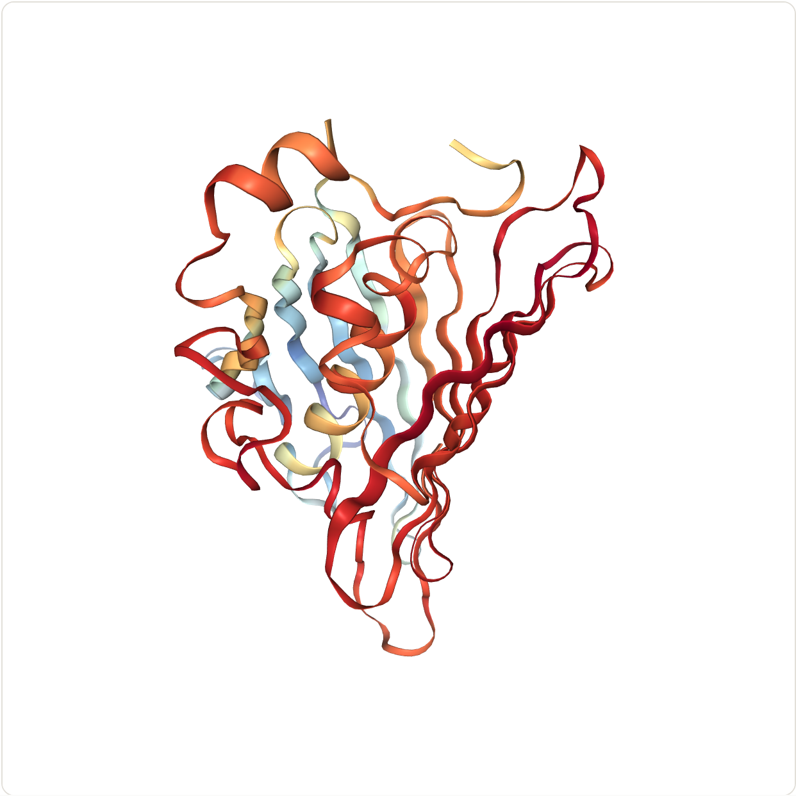
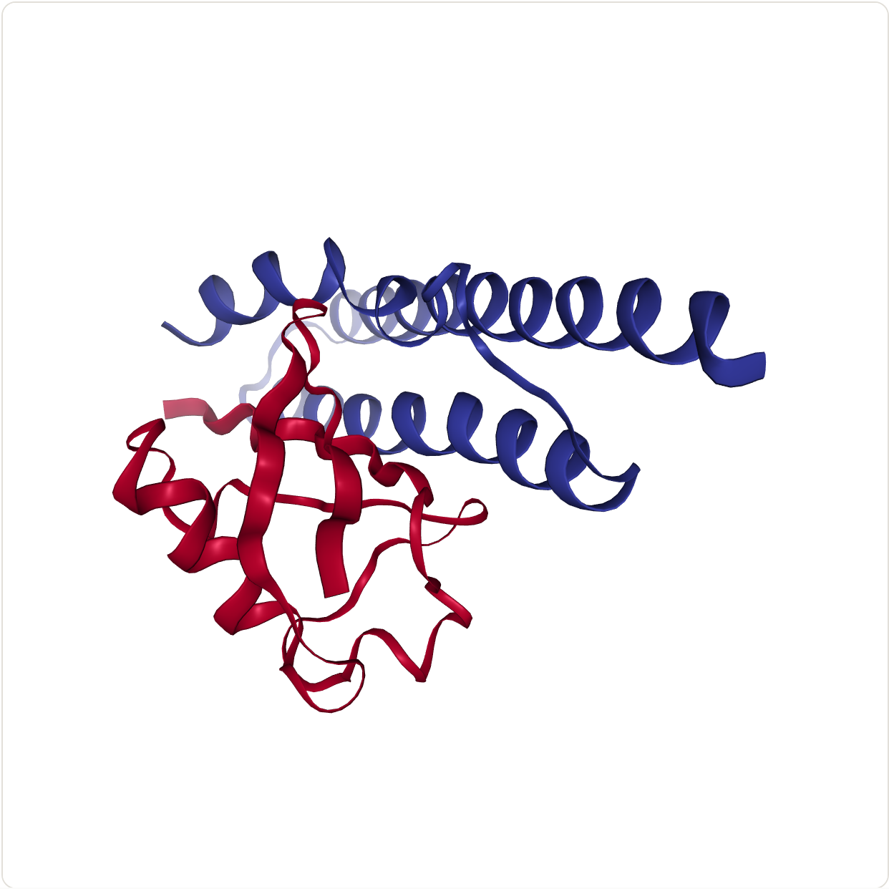
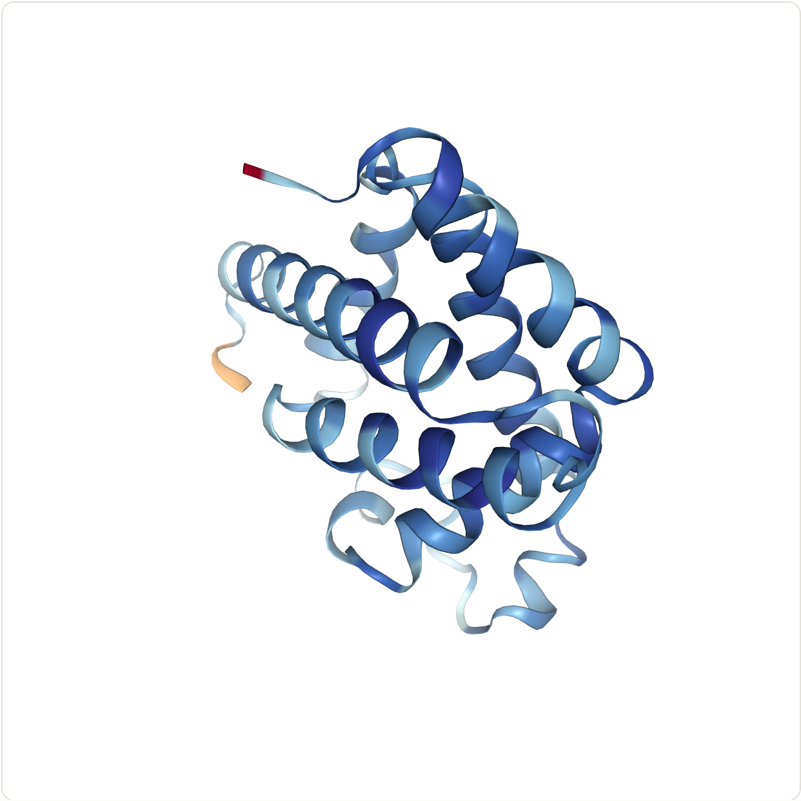
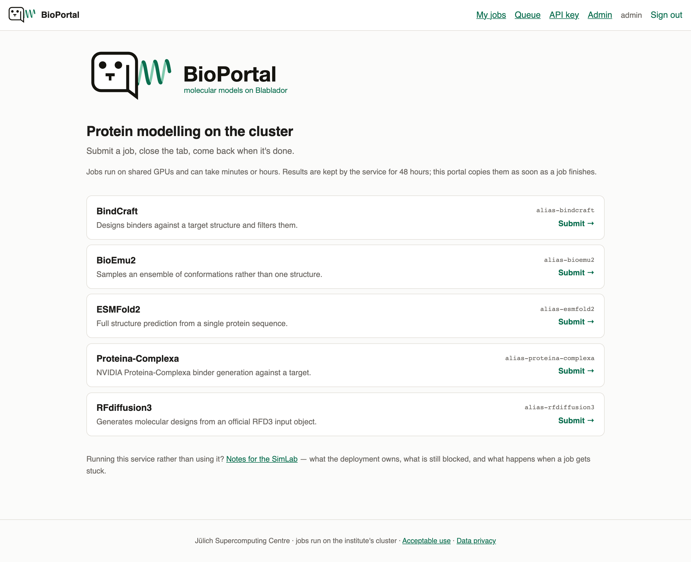
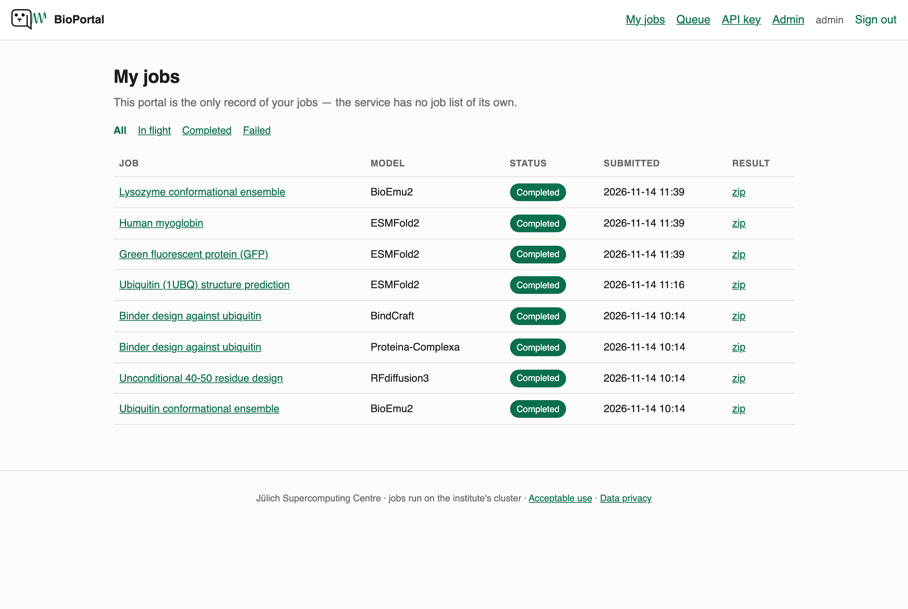

# BioPortal

Web frontend for the five molecular models on Blablador: Proteina-Complexa,
BindCraft, RFdiffusion3, ESMFold2 and BioEmu2.

One Django app, one page per model. Users sign in with their JSC account,
submit a job, close the tab, and come back — or get an email — when it's done.

<picture>
  <source media="(prefers-color-scheme: dark)" srcset="docs/img/job-detail-dark.png">
  
</picture>

Structures produced through the portal against the live service, rendered by
its in-browser viewer:

<table>
<tr>
<td width="33%"></td>
<td width="33%"></td>
<td width="33%"></td>
</tr>
<tr>
<td align="center"><sub><b>ESMFold2</b> — GFP, 238 residues</sub></td>
<td align="center"><sub><b>BindCraft</b> — designed binder on ubiquitin, 2 chains</sub></td>
<td align="center"><sub><b>ESMFold2</b> — myoglobin, 154 residues</sub></td>
</tr>
</table>

<table>
<tr>
<td width="50%">
<picture>
  <source media="(prefers-color-scheme: dark)" srcset="docs/img/home-dark.png">
  
</picture>
</td>
<td width="50%">
<picture>
  <source media="(prefers-color-scheme: dark)" srcset="docs/img/job-list-dark.png">
  
</picture>
</td>
</tr>
</table>

## How it fits together

```
browser ──POST──► Django ──POST /v1/responses──► Blablador shim ──► GPU workers
   ▲                 │          (key held here)
   │ HTMX poll       │ Job row
   └─────────────────┤
                     │
          reconcile ─┴── status / artifact ──► local artifact store
                     └──► completion email
```

The browser never talks to Blablador: CORS and direct-browser credential
handling weren't validated in that deployment, so every action is proxied.

**Each user supplies their own Blablador API key**, so GPU time meters to their
account rather than a shared service credential. Keys are encrypted at rest
with `CREDENTIAL_ENCRYPTION_KEY` (Fernet, held in the environment, never in the
database), shown back only as an 8-character fingerprint, and never logged.
They must be *stored* rather than session-held, because the reconciler needs
them to poll and download results long after the user has closed the browser —
that tradeoff is stated plainly on the key page. A rejected key is flagged and
the user is asked to replace it; their running jobs are left alone, since the
computation is unaffected by us being unable to watch it.

Each action is `POST /v1/responses` with `stream: false` and `input` as a JSON
**string**. The outer response completing means the *API action* completed —
never the computation. Only `molecular_job` is believed.

### The four jobs of the reconciler

`manage.py reconcile --loop` runs 24/7 and is the only thing that advances a job:

1. **Retries ambiguous submissions.** A `pending` row with no job ID is resent
   with the *same* `request_id` and parameters; the shim derives a stable job ID
   from that pair, so a retry returns the original job instead of a duplicate.
2. **Polls** each job at its own `poll_after_seconds` (never faster than 10s).
3. **Downloads artifacts** as soon as a job completes — see retention, below.
4. **Flags stale jobs** for operations.

## Things the protocol forces, and how they're handled

**Results expire after 48 hours.** This is the sharpest edge. The reconciler
copies the archive to `ARTIFACT_ROOT` the moment a job completes rather than
waiting for a user to click download, so a result survives the user being on
holiday. If it expires first, the UI says so plainly instead of showing a dead
link. Admins can retry a fetch from the Django admin while the window is open.

**Artifacts are chunked base64, up to 2 GB, with no download URL.** Assembled
server-side into a `.part` file, offset advanced by *decoded* byte count (not
base64 string length), renamed only when `total_bytes` have arrived — a partial
download can never masquerade as a result. Transient chunk failures retry the
same offset with jittered backoff.

**A failed HTTP request is not a failed computation.** Transient errors only
touch `consecutive_poll_errors` and `poll_after`; job status is left alone and
the page says "we can't reach the service, your job is unaffected". 404 is the
one exception — the job is genuinely gone.

**A finished job is not a sound result.** `jobs/structure.py` measures the
distance between consecutive alpha carbons, which covalent geometry fixes near
3.8 A. A chain averaging 10 A is not folded. The check runs on every downloaded
archive, is shown on the job page when it fails, and is recorded as a job
event. ESMFold2's form also refuses step/loop combinations observed to produce
unfoldable output, so the GPU time is never spent. Passing says the backbone is
connected, not that the prediction is right.

**Structure previews are prepared server-side.** The browser's mmCIF parser
rejects the minimal CIF these models emit, and RFdiffusion3 returns it gzipped,
so `/jobs/<id>/preview.pdb` extracts the largest structure from the archive,
decompresses it, converts mmCIF to PDB and serves that. The viewer is then just
NGL over plain PDB, with no archive handling in the browser.

**No upstream job list exists.** Our database is the only record of who owns
which job ID, which is also why `/jobs/` is per-user and there is no global job
browser over shared storage.

**No progress percentage, no ETA.** `estimated_*` fields are documented as null,
so the UI shows queue position, `stage`/`message`, and `waiting_reason`, and
states outright that no ETA exists. A test asserts no percentage or progress bar
creeps in. Queue position is labelled as order, not a start guarantee.

**Cancellation is a race.** A running job goes to `cancelling` and may still
complete. The UI says that rather than implying the job stopped.

**Stale running jobs.** There's no lease-based recovery and no per-job liveness
API upstream, so a lost worker leaves a job `running` forever. After
`STALE_RUNNING_SECONDS` (default 30 h) the job is flagged, surfaced in the admin
"Trouble" column, and the user is told to contact operations with the job ID.
It is deliberately *not* auto-failed — we can't know the computation died.

**Model-specific traps**, encoded in the forms:

- Proteina-Complexa's `target_input` is **required**; the adapter's `A1-76`
  fallback is the ubiquitin canary and is never sent for an uploaded target.
  Its `hotspots` is a list, unlike BindCraft's hotspot string.
- BioEmu2's `msa_mode` is an explicit visible choice, since single-sequence mode
  means no MSA search and differs scientifically from an MSA run.
- RFdiffusion3's `input` is an official RFD3 object; the form validates it as
  JSON and rejects English prompts.
- BindCraft's filters can return fewer designs than requested, and its seed
  isn't wired into the CLI — both stated on the submit page.
- ESMFold2 produces one prediction and ignores `samples`/`seed`.

Validation bounds (`samples` 1–128, `steps` 1–1000, `num_loops` 1–8,
`max_trajectories` 1–10000, `walltime_seconds` ≤ 86400, 12 MB parameters) are
enforced client-side too, so a bad request never leaves the building. They're
bounds, not a promise that a combination fits in GPU memory.

**Logging.** Keys, sequences, structures and full request bodies are never
logged, and completion emails carry no parameters.

## Layout

| Path | What's in it |
|---|---|
| `jobs/blablador.py` | The shim client: actions, typed errors, chunked artifact fetch |
| `jobs/registry.py` | `ModelSpec` — the plugin contract |
| `jobs/specs/*.py` | One module per model: form + `parameters` builder |
| `jobs/management/commands/reconcile.py` | The 24/7 loop |
| `jobs/models.py` | `Job`, including `apply_remote()` |
| `jobs/auth.py` | Helmholtz AAI / JSC OIDC backend |
| `jobs/notify.py` | Completion email, exactly-once |

## Adding a sixth model

Write `jobs/specs/yourmodel.py` with a form and `build(cleaned) -> parameters`,
call `register(ModelSpec(...))` with the alias from `GET /v1/models`, and add the
module to `load_specs()`. It appears on the homepage with its own page, queue
entry and result view.

## Running it

```bash
python -m venv .venv && .venv/bin/pip install -r requirements.txt
cp .env.example .env     # then fill it in
.venv/bin/python manage.py migrate
.venv/bin/python manage.py createsuperuser
.venv/bin/python manage.py runserver
```

Production: `gunicorn bioportal.wsgi` behind nginx, plus

```ini
# /etc/systemd/system/bioportal-reconcile.service
[Unit]
Description=BioPortal job reconciler
After=network.target

[Service]
User=bioportal
WorkingDirectory=/srv/bioportal
Environment=BIOPORTAL_ENV_FILE=/srv/bioportal/.env
ExecStart=/srv/bioportal/.venv/bin/python manage.py reconcile --loop
Restart=always
RestartSec=10

[Install]
WantedBy=multi-user.target
```

Run exactly one reconciler. `ARTIFACT_ROOT` needs room for 48 hours of results
and should be backed up or pruned on your own schedule.

## Deployment (blablador-import)

Deployed to the `bioportal` namespace of the `blablador-import` cluster:

```bash
docker buildx build --platform linux/amd64 \
  -t registry.jsc.fz-juelich.de/kaas/rke2-clusters/blablador/bioportal:<tag> --push .
kubectl -n bioportal apply -f k8s/
```

The cluster is amd64; building on an Apple Silicon machine without
`--platform linux/amd64` produces an image that fails with
`exec format error`.

| Piece | Notes |
|---|---|
| `bioportal-web` | 2 replicas, gunicorn + WhiteNoise. Migrations run in an init container, once per rollout. |
| `bioportal-reconcile` | **Exactly 1 replica.** A second would duplicate artifact downloads and completion emails. |
| `bioportal-db` | Postgres 16 on a 10 Gi Longhorn volume. |
| `bioportal-artifacts` | 100 Gi, **ReadWriteMany** — the reconciler writes archives and both web replicas serve them, so RWO deadlocks as soon as pods land on different nodes. |
| Ingress | Traefik, `bioportal.blablador.fz-juelich.de`, cert-manager `letsencrypt-prod-cluster`. |

`k8s/config.yaml` is committed; the Secret is not. Create it once:

```bash
kubectl -n bioportal create secret generic bioportal-secrets \
  --from-literal=DJANGO_SECRET_KEY="$(python -c 'import secrets;print(secrets.token_urlsafe(50))')" \
  --from-literal=DB_PASSWORD="$(python -c 'import secrets;print(secrets.token_urlsafe(24))')" \
  --from-literal=CREDENTIAL_ENCRYPTION_KEY="$(python -c 'from cryptography.fernet import Fernet;print(Fernet.generate_key().decode())')"
```

`CREDENTIAL_ENCRYPTION_KEY` must stay stable: rotating it makes every stored
user API key undecryptable and everyone must re-enter theirs.

Probes hit `/healthz`, which touches no database — a Postgres blip should not
make Kubernetes kill every web pod. They pass an explicit `Host` header because
`ALLOWED_HOSTS` is deliberately strict and kube-probe otherwise sends the pod IP.

## Authentication

Register the client through Helmholtz AAI's self-service at
<https://login.helmholtz.de/oauthhome> (a dev instance for testing lives at
login-dev.helmholtz.de). AAI administrators review each request and the client
does not work until accepted, so allow time. Registration also requires a
Service Security Contact, who must be reachable during a security incident and
registered at the Infrastructure Security Point, plus a privacy policy and
acceptance of the AAI Top Level Policy and SIRTFI.

Values for this deployment:

| Field | Value |
|---|---|
| Redirect URI | `https://bioportal.blablador.fz-juelich.de/oidc/callback/` |
| Logout redirect | `https://bioportal.blablador.fz-juelich.de/oidc/logout/` |
| Flow | authorization code (confidential client) |
| Scopes | `openid email profile eduperson_entitlement` |
| ID token algorithm | RS256 |

The username and password the self-service issues are the client ID and
secret; put them in the `bioportal-secrets` Secret as `OIDC_CLIENT_ID` and
`OIDC_CLIENT_SECRET`.

`manage.py checkoidc` compares the configured endpoints against the provider's
discovery document and prints the redirect URIs to register. Worth running:
the endpoints cannot be guessed from the issuer URL — authorization lives
under `/oauth2-as/oauth2-authz` and the JWKS at `/jwk`, not `/jwks`.

- **Users** — `/oidc/authenticate/`, Helmholtz AAI. `OIDC_ALLOWED_ENTITLEMENTS`
  restricts access to your group; empty accepts any successful login, which is
  fine for a pilot but should be tightened before announcing the service.
- **You** — Django local password login at `/login/`, full admin at `/admin/`:
  every job, its events, the "Trouble" column, re-notify and re-fetch actions.

A federated login never grants staff rights; those are set locally.

## Tests

```bash
.venv/bin/python manage.py test jobs
```

38 tests, network stubbed. They cover the protocol details that are easy to get
wrong: `input` is a JSON string, the `output[0].content[0].text` fallback, HTML
gateway errors treated as transient, artifact offsets advanced by decoded bytes,
partial downloads discarded, idempotent resubmission reusing the request ID,
transient failures leaving job status untouched, expired artifacts reported
honestly, stale jobs flagged rather than failed, per-model parameter traps, and
that no invented progress or ETA appears in the UI.

## Not done

- **Not run against the live service.** Every test stubs the network; the shim's
  real responses may differ in detail from the handoff.
- **No billing integration.** Native `gpu_seconds` is displayed as reported;
  there's no currency conversion, because no rate was established.
- **Result previews** are a client-side NGL render of the first structure found
  in the archive. BioEmu2 trajectories and design sets show file listings only.
- **`GET /v1/models` is not consulted at runtime**; aliases are hardcoded in the
  specs. Worth wiring up a readiness check if aliases start moving.
